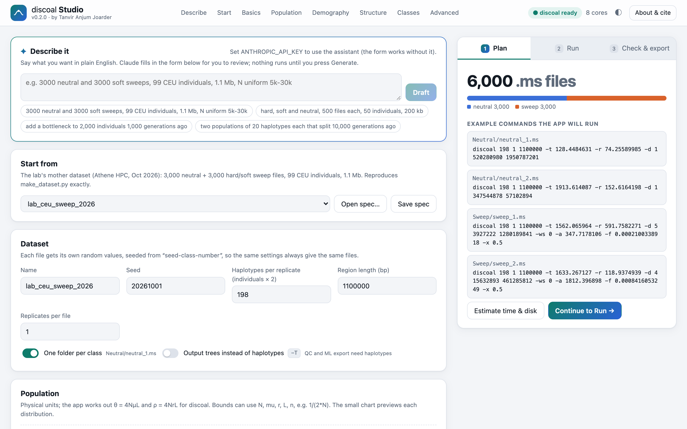
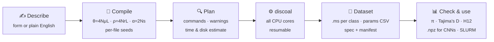
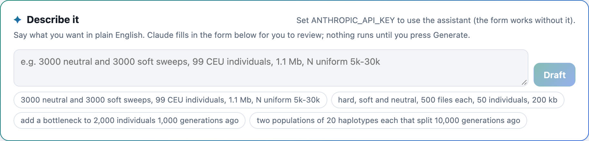
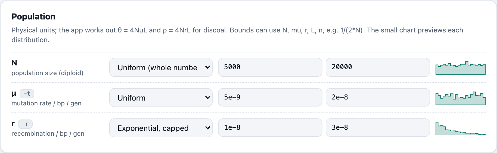
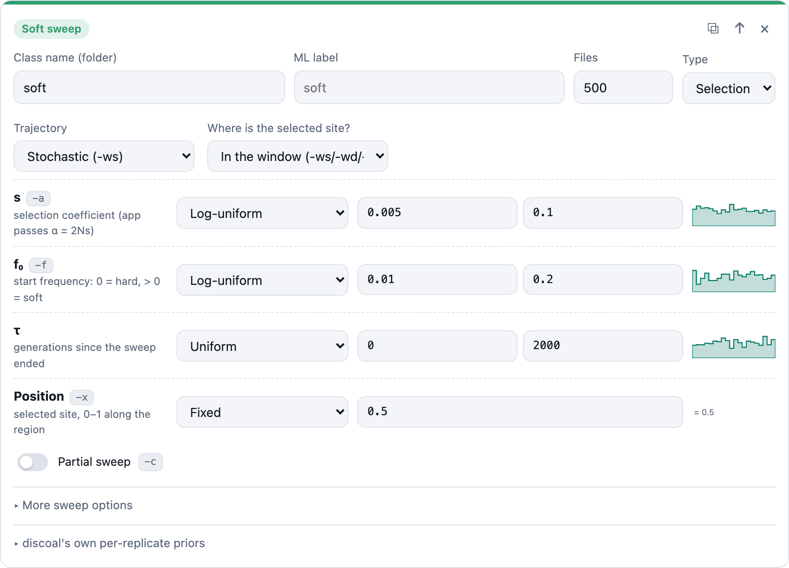
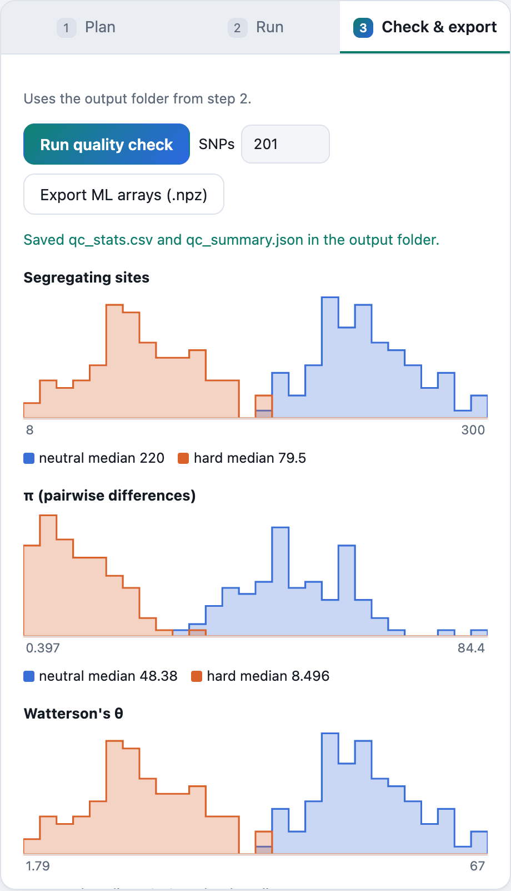

<div align="center">

# discoal Studio

**Build selective-sweep training datasets with [discoal](https://github.com/kr-colab/discoal), on your own computer.**
<br>No terminal, no HPC account, no hand-written script. On macOS, Windows and Linux.

[](https://github.com/tanviranjumjoarder/discoal-studio/actions/workflows/build.yml)
[](https://github.com/tanviranjumjoarder/discoal-studio/releases/latest)
[](LICENSE)


[**Download**](#download) · [**User manual**](docs/USER_MANUAL.md) · [**Quick start**](#quick-start) · [**Cite**](#citing)

<picture>
  <source media="(prefers-color-scheme: dark)" srcset="docs/images/plan-dark.png">
  
</picture>

*By Tanvir Anjum Joarder (Florida Atlantic University). Built on discoal by Kern & Schrider.*

</div>

---

## What it does

You describe the dataset you want: population size, mutation and recombination
rates, sweep strength, demography, and how many `.ms` files of each class. You can
fill in the form or **type it in plain English**. discoal Studio:

1. converts everything to discoal's scaled units (θ = 4NμL, ρ = 4NrL, α = 2Ns, τ/4N) and draws
   each file's parameters from the distributions you chose,
2. shows you the **exact discoal commands**, warnings and a time and disk estimate *before* anything runs,
3. runs discoal on **all your CPU cores** (at low priority, so the computer stays usable),
4. writes the `.ms` files, one parameter table per class, a reproducibility manifest,
   **quality-check plots** and **ML-ready arrays**.



## Why

Most sweep-detection work (diploS/HIC, Flex-sweep, CNN classifiers) trains on thousands
of discoal simulations, and every lab writes its own script to make them. The unit
conversions in those scripts are easy to get wrong and hard to check afterwards. The
script, the seeds and the exact discoal build also tend to get lost. discoal Studio
turns that script into a tested, reproducible tool:

| | Hand-written script | discoal Studio |
|---|---|---|
| **Units** | convert by hand | enter N, μ, r, s and generations; conversion is automatic and tested |
| **Priors** | code each one | fixed, uniform, uniform-int, log-uniform, capped exponential; bounds can use other values (`1/(2*N)`) |
| **Compute** | HPC queue | every core of your PC, or export a SLURM job array |
| **Crashes** | start over | resumes; finished files are kept |
| **Reproducibility** | depends on the script | per-file seeds, `spec.json`, `manifest.json` with discoal hashes, a `verify` command |
| **Checking** | separate notebook | built-in π, θ_W, Tajima's D, H12 and H2/H1 plots per class |
| **ML input** | separate script | `.npz` haplotype arrays (files × haplotypes × SNPs) |

> **Exact reproduction.** The built-in preset `lab_ceu_sweep_2026` regenerates a
> 6,000-file dataset first made on a Linux HPC cluster. On a Mac, all 6,000 `.ms`
> files come out **byte-identical** to the originals in 9 minutes on 7 cores. The test
> suite checks this on every push.

## Screenshots

<table>
<tr>
<td width="50%"><br><b>Describe it.</b> Type the dataset in plain English; Claude fills in the form for you to review.</td>
<td width="50%"><br><b>Priors in physical units.</b> Each one shows a small preview of its distribution.</td>
</tr>
<tr>
<td><br><b>Classes are your labels.</b> Hard, soft, partial, old, linked and recurrent sweeps, each with its own priors.</td>
<td><br><b>Check before you train.</b> Summary statistics by class, computed from the files themselves.</td>
</tr>
</table>

## Features

- **Covers every discoal option**, each one optional and in physical units: hard and soft sweeps,
  stochastic/deterministic/neutral trajectories, partial sweeps, sweeps left of the window,
  recurrent hitchhiking, recurrent mutation, size changes, several populations, splits,
  admixture, migration, ancient samples and gene conversion
  ([full list](docs/USER_MANUAL.md#every-discoal-option)).
- **Any number of classes**, each with its own folder, file count and parameter table. There are
  one-click templates, and classes can share an ML label (hard + soft → "sweep").
- **Plain-English assistant (optional)**: "3000 neutral and 3000 soft sweeps, 99 CEU individuals,
  1.1 Mb". Claude fills in the typed form, never the discoal commands, and nothing runs until you
  press Generate. There is also an **MCP server**, so other AI assistants can use the app.
- **Patched discoal bundled**: it fixes an out-of-bounds write (`sweepPopn`) and a crash in
  recurrent hitchhiking (`-R/-L`), and adds a small compatibility layer so discoal builds on
  Windows. Each patch is in `vendor/discoal/`.
- **Safe to stop**: closing the window or pressing Stop kills discoal cleanly. Half-written
  files never appear, and Generate continues where it stopped.
- **HPC export**: a SLURM job-array script plus `commands.txt` for GNU parallel.
- **Same engine on the command line**, for scripts and clusters.

## Download

| System | File | How to install |
|---|---|---|
| **Windows 10/11** (64-bit) | `discoal-studio-<version>-windows-x64-setup.exe` | Run it and follow the wizard. No admin rights are needed. |
| **macOS** (Apple silicon) | `discoal-studio-<version>-macos-arm64.dmg` | Open it and drag *discoal Studio* to Applications. |
| **macOS** (Intel) | `discoal-studio-<version>-macos-x86_64.dmg` | Same as above. |
| **Linux** (x86-64) | `discoal-studio-<version>-linux-x86_64.tar.gz` | Unpack it and run `discoal-studio/discoal-studio`. |

Get them from the **[latest release](https://github.com/tanviranjumjoarder/discoal-studio/releases/latest)**.
The installers are not yet signed by Apple or Microsoft, so the first launch needs one extra click:

- **Windows:** in the blue SmartScreen box, click *More info → Run anyway*.
- **macOS:** if it says the app "cannot be opened", go to *System Settings → Privacy & Security* and click *Open Anyway*.

Step-by-step instructions with troubleshooting are in the
[user manual](docs/USER_MANUAL.md#1-install).

### With pip (any OS, Python ≥ 3.10)

```bash
pip install "discoal-studio[desktop] @ git+https://github.com/tanviranjumjoarder/discoal-studio"
```
```bash
discoal-studio
```
The first time it runs, the app compiles discoal, which takes a few seconds and needs a C compiler:
`xcode-select --install` on macOS, `sudo apt install build-essential` on Ubuntu, or
[MinGW-w64](https://winlibs.com/) on Windows. Add `[assistant]` to the brackets for the
plain-English assistant and `[mcp]` for the MCP server.

## Quick start

1. Open **discoal Studio**. It starts with the small `quick_demo` preset: 100 neutral and 100 hard sweep files.
2. In the right panel, check the file count and the example discoal commands, then click
   **Estimate time & disk**.
3. Click **Continue to Run**, choose an output folder, and click **Generate dataset**.
   The demo takes a few seconds.
4. Open **Check & export** and click **Run quality check**. Sweep files should show lower π,
   negative Tajima's D and higher H12 than neutral ones.
5. Click **Export ML arrays** to get `ml/haplotypes_201snps.npz` for your classifier.

```python
import numpy as np
d = np.load("my_dataset/ml/haplotypes_201snps.npz")
X, y = d["X"], d["y"]          # X: (files, haplotypes, SNPs) of 0/1, y: class index
print(X.shape, d["classes"])   # e.g. (200, 50, 201) ['neutral' 'hard']
```

To design your own dataset, change the preset or start from the form. Everything is explained in the
**[user manual](docs/USER_MANUAL.md)**.

## Command line

The installed app and the pip package include the same engine as a command-line tool:

```text
discoal-studio                         open the app
discoal-studio presets                 list built-in presets
discoal-studio plan SPEC               warnings + example commands, runs nothing
discoal-studio estimate SPEC           pilot run: time and disk estimate
discoal-studio run SPEC --out DIR      generate (resumes; --workers N; --shard k/n)
discoal-studio qc DIR                  qc_stats.csv + qc_summary.json
discoal-studio export-ml DIR --snps K  ml/haplotypes_<K>snps.npz
discoal-studio export-hpc SPEC FOLDER  spec.json + run_<name>.slurm + commands.txt
discoal-studio verify DIR              re-simulate a few files and confirm they are identical
discoal-studio build-discoal           (re)compile the bundled discoal
discoal-studio cite                    how to cite discoal Studio and discoal
discoal-studio-mcp                     MCP server (stdio) for AI assistants
```
`SPEC` is a JSON file saved from the app, or a preset name, for example `discoal-studio run quick_demo --out demo`.

## What you get

```
my_dataset/
├── Neutral/neutral_1.ms …          one folder per class
├── Sweep/sweep_1.ms …
├── params_neutral.csv              every drawn value, the seeds and the exact command, per file
├── params_sweep.csv
├── spec.json                       the design; rerun with: discoal-studio run spec.json --out …
├── manifest.json                   app version, discoal source/binary hashes, compiler, machine, failures
├── qc_stats.csv, qc_summary.json   after the quality check
└── ml/haplotypes_201snps.npz       after the ML export: X, positions, y, classes, files
```

## For developers

```bash
git clone https://github.com/tanviranjumjoarder/discoal-studio && cd discoal-studio
```
```bash
uv venv && uv pip install -e ".[desktop,dev]"
```
```bash
uv run pytest
```
```bash
./packaging/build.sh
```
`build.sh` makes the installer for the system it runs on: a `.dmg` on macOS, a setup `.exe`
(Inno Setup) on Windows from Git Bash, or a `.tar.gz` on Linux. GitHub Actions runs the tests on
all three systems for every push. Pushing a `v*` tag builds every installer and attaches it to
the release.

Layout: `spec.py` holds the dataset model, `priors.py` the distributions, `compiler.py` turns a spec
into commands, `runner.py` runs discoal in parallel, `analysis.py` does the QC and ML export,
`server.py` and `static/` are the app, `assistant.py` and `mcp_server.py` are the AI parts, and
`vendor/discoal/` is discoal's source with its patches.

## Citing

If you use discoal Studio, or data made with it, please cite both:

> Joarder, T. A. (2026). *discoal Studio: reproducible discoal selective-sweep datasets on your own
> computer* (version 0.2.0) [Computer software]. https://github.com/tanviranjumjoarder/discoal-studio
>
> Kern, A. D. and Schrider, D. R. (2016). Discoal: flexible coalescent simulations with selection.
> *Bioinformatics* 32(24):3839–3841. doi:10.1093/bioinformatics/btw556

GitHub's **Cite this repository** button (from `CITATION.cff`), the app's *About & cite* dialog and
`discoal-studio cite` all give the same text, plus BibTeX.

## License

Copyright © 2026 Tanvir Anjum Joarder. Licensed under the
[GPL-3.0-or-later](LICENSE), with the attribution terms in [`NOTICE`](NOTICE): if you share the
program or a modified version, you must keep the author attribution and mark your changes.
The GPL is required because the app ships discoal, which is GPL-3.0; its source and license are in
`src/discoal_studio/vendor/discoal`. See [`docs/authorship.md`](docs/authorship.md) for more.
