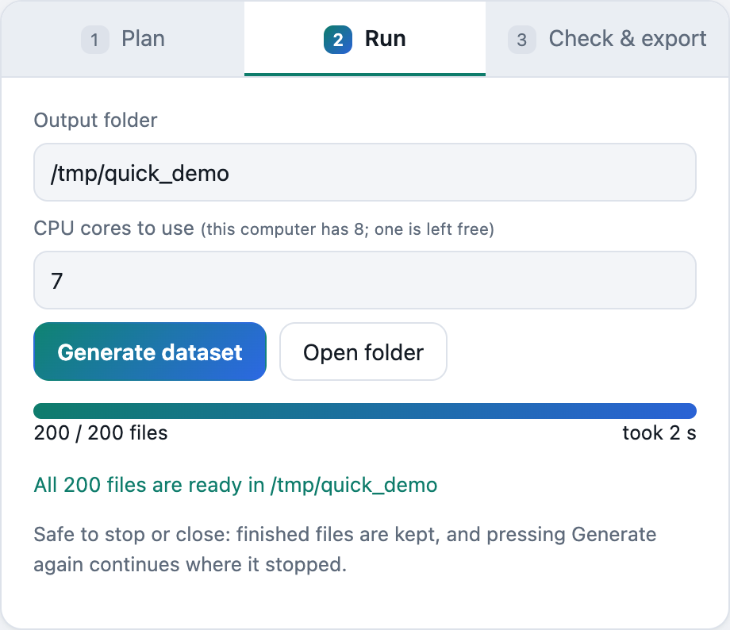

# discoal Studio: user manual

Version 0.2.0. This manual covers installing the app, designing a dataset, running it,
checking the result and using it for machine learning. You only need the
[README](../README.md) for a quick look.

**Contents**

1. [Install](#1-install)
2. [A first dataset in five minutes](#2-a-first-dataset-in-five-minutes)
3. [The window at a glance](#3-the-window-at-a-glance)
4. [Designing a dataset](#4-designing-a-dataset)
   - [Describe it (plain English)](#41-describe-it-plain-english)
   - [Start from](#42-start-from)
   - [Dataset](#43-dataset)
   - [Population and priors](#44-population-and-priors)
   - [Demography](#45-demography)
   - [Population structure](#46-population-structure)
   - [Classes](#47-classes)
   - [Advanced](#48-advanced)
5. [Plan: check before you run](#5-plan-check-before-you-run)
6. [Run](#6-run)
7. [Check & export](#7-check--export)
8. [Running on an HPC cluster](#8-running-on-an-hpc-cluster)
9. [Command line](#9-command-line)
10. [The spec file](#10-the-spec-file)
11. [Every discoal option](#every-discoal-option)
12. [Reproducibility](#12-reproducibility)
13. [AI assistant and MCP server](#13-ai-assistant-and-mcp-server)
14. [Troubleshooting](#14-troubleshooting)
15. [Uninstall](#15-uninstall)

---

## 1. Install

Download the file for your computer from the
[latest release](https://github.com/tanviranjumjoarder/discoal-studio/releases/latest).
Each installer contains everything it needs, including a compiled copy of discoal, so you don't need Python
or a compiler.

### Windows 10 / 11 (64-bit)

1. Download `discoal-studio-<version>-windows-x64-setup.exe`.
2. Double-click it. Windows SmartScreen may say *"Windows protected your PC"*, because the
   installer is not signed yet. Click **More info**, then **Run anyway**.
3. Follow the wizard. By default it installs for your user only, so you don't need admin rights.
   Tick *Create a desktop shortcut* if you want one.
4. Start **discoal Studio** from the Start menu.

The app window uses Microsoft Edge WebView2, which comes with Windows 11 and up-to-date Windows 10.
If WebView2 is missing, the app opens in your default browser instead and works the same way.

If you prefer not to install anything, the release also has a `…-windows-x64.zip`: unzip it anywhere
and run `discoal-studio.exe`.

### macOS

1. Download the `.dmg` for your Mac: `macos-arm64` for Apple silicon (M1 and later),
   `macos-x86_64` for Intel. To check which you have, open  → *About This Mac*.
2. Open the `.dmg` and drag **discoal Studio** into **Applications**.
3. Open it from Applications. The app is not notarized by Apple yet, so the first time macOS may say it
   *"cannot be opened"* or *"cannot verify the developer"*. Then:
   - open **System Settings → Privacy & Security**, scroll down, and click **Open Anyway**
     next to the discoal Studio message, then confirm;
   - on older macOS versions, you can instead right-click the app and choose **Open**.

   You only need to do this once.

### Linux (x86-64)

```bash
tar -xzf discoal-studio-<version>-linux-x86_64.tar.gz
```
```bash
./discoal-studio/discoal-studio
```
For a native window, install the GTK WebKit libraries (`sudo apt install gir1.2-webkit2-4.1`
on Ubuntu). Without them, the app opens in your browser.

### With pip (any system, Python 3.10 or newer)

```bash
pip install "discoal-studio[desktop] @ git+https://github.com/tanviranjumjoarder/discoal-studio"
```
```bash
discoal-studio
```
The pip version compiles discoal the first time it runs, so it needs a C compiler: Xcode command line
tools on macOS (`xcode-select --install`), `build-essential` on Debian/Ubuntu, or MinGW-w64 gcc on
Windows (for example `winget install BrechtSanders.WinLibs.POSIX.UCRT`). Optional extras:
`[assistant]` for the plain-English assistant, `[mcp]` for the MCP server.

---

## 2. A first dataset in five minutes

1. Open discoal Studio. It loads the **quick_demo** preset: 100 neutral and 100 hard sweep files,
   50 haplotypes, 100 kb.
2. Look at the right-hand panel (**1 · Plan**). It says *200 .ms files* and lists the first discoal
   commands for each class. Click **Estimate time & disk**. A few test files run and the app tells
   you how long the whole set will take and how much disk it needs.
3. Click **Continue to Run**. Check the **Output folder** (by default
   `~/discoal-studio-datasets/<name>`) and click **Generate dataset**. The progress bar fills in a
   few seconds.

   

4. Open **3 · Check & export** and click **Run quality check**. You get one histogram per
   statistic, with one colour per class. In a working sweep dataset, the sweep class has fewer
   segregating sites, lower π, more negative Tajima's D and higher H12 than the neutral class.

   

5. Click **Export ML arrays (.npz)** to get a file you can load straight into NumPy, PyTorch or
   TensorFlow (see [section 7](#7-check--export)).

---

## 3. The window at a glance


- **Top bar:** jump links to each section of the form; a *discoal ready* chip (hover it to see which
  discoal binary is used and its hash); the number of CPU cores; a light/dark switch; and
  **About & cite**.
- **Left: the form.** Everything about the dataset, from top to bottom: *Describe it*, *Start from*,
  *Dataset*, *Population*, *Demography*, *Population structure*, *Classes*, *Advanced*.
- **Right: three steps.** **1 · Plan** shows what will run, **2 · Run** runs it, and
  **3 · Check & export** checks the result.

Every change in the form updates the Plan panel at once. Nothing is simulated until you
press **Generate dataset**.

---

## 4. Designing a dataset

All values are entered in **physical units**: individuals, per-base-pair-per-generation rates and
generations. The app converts them to discoal's scaled units for you (see
[the conversion table](#how-inputs-become-discoal-flags)). Each field is labelled with the discoal
flag it controls, for example `-a` or `-en`.

### 4.1 Describe it (plain English)


Type what you want, for example:

> 3000 neutral and 3000 soft sweeps, 99 CEU individuals, 1.1 Mb, N uniform 5k–30k

and click **Draft**. Claude fills in the form below and writes a short summary. Next to the summary,
the app prints its own outline of the spec, so you can compare the two. You can keep refining with
follow-ups like *"now 100 files per class"* or *"add a bottleneck to 2,000 individuals 1,000
generations ago"*. **Undo** restores the form as it was before. The chips under the box are example
requests you can click.

Nothing runs until you press **Generate dataset** yourself. This box needs an Anthropic API key (see
[section 13](#13-ai-assistant-and-mcp-server)); without one it is disabled, and the rest of the app
works normally.

### 4.2 Start from

Pick a **preset**, open a saved **spec** (`.json`), or save the current one with **Save spec**. A
spec file is the complete design of a dataset. Share it with coauthors or put it in a paper's
supplement, and anyone can regenerate exactly the same files.

| Preset | What it is |
|---|---|
| `quick_demo` | 100 neutral + 100 hard sweeps, 50 haplotypes, 100 kb. About a minute or less. |
| `hard_soft_neutral` | Three classes × 500 files, sweeps ended 0–2,000 generations ago. |
| `partial_sweep_bottleneck` | Neutral vs partial sweeps under an illustrative bottleneck. |
| `lab_ceu_sweep_2026` | 3,000 neutral + 3,000 hard/soft sweeps, 198 haplotypes (99 CEU individuals), 1.1 Mb. Reproduces the author's original HPC dataset byte for byte. |

### 4.3 Dataset

| Field | Meaning |
|---|---|
| **Name** | Used for the output folder name and the SLURM job name. |
| **Seed** | Every file's random numbers start from the text `seed-class-number`, e.g. `20261001-sweep-17`. The same seed always gives the same files; change it to get a new, independent dataset. |
| **Haplotypes per replicate** | The sample size: number of chromosomes, i.e. individuals × 2 for diploids. |
| **Region length (bp)** | The simulated window, also the number of sites. |
| **Replicates per file** | Usually 1, meaning one simulation per `.ms` file. |
| **One folder per class** | `Neutral/neutral_1.ms`, `Sweep/sweep_1.ms`, … (on by default). |
| **Output trees instead of haplotypes** (`-T`) | Newick genealogies instead of 0/1 haplotypes. The quality check and ML export need haplotypes, so they don't work with this on. |

### 4.4 Population and priors


Each file draws its own **N** (population size), **μ** (mutation rate per bp per generation) and
**r** (recombination rate per bp per generation). For each one you choose a distribution:

| Distribution | Fields | Use it for |
|---|---|---|
| Fixed | value | a constant |
| Uniform | low, high | any value in a range, all equally likely |
| Uniform (whole numbers) | low, high | e.g. N from 5,000 to 30,000 |
| Log-uniform | low, high | quantities spanning orders of magnitude (s, f₀). Each ×2 step is equally likely |
| Exponential, capped | mean, upper | e.g. r with mean 1e-8, redrawn while above 3e-8 |

The small chart next to each row previews the distribution.

**Bounds can be formulas** that use values already drawn for the same file: `N`, `mu`, `r`, `L`
(region length) and `n` (sample size). For example, the lowest possible starting frequency of a soft
sweep is one copy, `1/(2*N)`. Allowed are numbers, those names, `+ - * / **` and brackets.

### 4.5 Demography

Instantaneous size changes, going **back in time** (discoal `-en`). Each change has a time in
**generations ago** and the **new size** in individuals. Both can be fixed or random. For example, a
bottleneck is a drop to 2,000 at 1,000 generations ago, then a recovery to the original size at 4,000
generations ago. Leave this empty for a constant population size.

### 4.6 Population structure

Optional, for multi-population models:

- **Populations** (`-p`): two or more sampled populations with their sample sizes, which must add up
  to the total. Population 0 is where sweeps happen.
- **Splits** (`-ed`): going back in time, one population joins another. Forward in time, that is a
  population split.
- **Admixture** (`-ea`): going back in time, a population divides into two founders with a given
  proportion.
- **Migration** (`-M` for all pairs, `-m` for one direction): the fraction of migrants per
  generation. The app passes 4Nm.
- **Ancient samples** (`-A`): some haplotypes are sampled in the past instead of today.

### 4.7 Classes


A **class** is one kind of file, and usually one label for your classifier. Each class has its own
name (which is also its folder), number of files, **ML label** and type (*Neutral* or *Selection*).
Classes with the same ML label are merged in the ML export, for example *hard* and *soft* → *sweep*.

The **Add a class** buttons at the bottom create ready-made classes: Neutral, Hard sweep, Soft sweep,
Partial sweep, Old sweep, Linked sweep (outside the window), Recurrent hitchhiking, Neutral fixation, or
Custom. Use the icons on each card to duplicate, move up or remove it.

For a selection class:

| Field | discoal | Meaning |
|---|---|---|
| **Trajectory** | `-ws` / `-wd` / `-wn` | stochastic (usual), deterministic, or neutral fixation |
| **Where is the selected site?** | `-ws…` / `-ls…` / `-R` / `-L` | in the window; left of the window (give the distance in bp); or recurrent sweeps at or beside the locus |
| **s** | `-a` | selection coefficient; the app passes α = 2Ns |
| **f₀** | `-f` | frequency when selection starts: 0 = hard sweep (new mutation), > 0 = soft sweep from standing variation |
| **τ** | `-ws τ/4N` | generations since the sweep ended; 0 = just finished |
| **Position** | `-x` | where the selected site is, 0–1 along the region |
| **Partial sweep** | `-c` | stop the sweep at this frequency; optionally hide the selected SNP (`-h`) |
| **More sweep options** | `-uA`, `-N`, `-i`, `-C` | recurrent beneficial mutation (θ_A = 4N·u_A), the population size used for the trajectory, the time step, and conditioning on recombination during the sweep |
| **discoal's own per-replicate priors** | `-Pt -Pr -Pa -Pu …` | discoal's built-in priors, in its scaled units, for when you use several replicates per file |

### 4.8 Advanced

Off unless you switch them on:

- **Gene conversion** (`-gr` or `-g`): a ratio to crossovers, or an absolute initiation rate per bp
  per generation, plus the mean tract length.
- **Only mutations younger than** (`-U`): drop mutations older than the given age in generations.

---

## 5. Plan: check before you run

The **1 · Plan** panel updates as you type:

- the **number of files**, with a bar split by class;
- **warnings** in plain language, for example *"f0 must be between 0 and 1"*, *"theta up to 25,000:
  files will be very large and slow"*, or *"alpha = 2Ns below 1: the sweep is nearly neutral"*.
  The app tries 200 files per class to find them;
- the **exact discoal commands** for the first files of each class. These are the real commands,
  seeds included;
- **Estimate time & disk**: runs 3 files per class in a temporary folder and projects the time on your
  cores and the disk space, and compares that with your free space. Sweep strength and N vary, so treat
  it as a guide.

---

## 6. Run

- **Output folder:** where the dataset goes. It is created if needed.
- **CPU cores to use:** by default all but one. discoal runs at low priority, so the computer stays
  responsive.
- **Generate dataset** starts the run. The bar shows files done, failures and the estimated time left.
- **Stop** kills discoal immediately. Finished files are kept and half-written ones are deleted. Press
  **Generate dataset** again with the same output folder to **continue where it stopped**. This also
  works after a crash, a reboot or closing the app.
- **Open folder** opens the output folder in Finder or Explorer.

If a file fails, the run keeps going. The failure, with discoal's error message and the exact command,
is listed in `manifest.json`.

---

## 7. Check & export

**Run quality check** reads every `.ms` file and computes, per file:

| Statistic | What a sweep usually does to it |
|---|---|
| Segregating sites | fewer |
| π (mean pairwise differences) | lower |
| Watterson's θ | lower |
| Tajima's D | more negative (excess of rare variants) |
| H12 (central SNPs) | higher (one dominant haplotype) |
| H2/H1 (central SNPs) | lower for hard sweeps, higher for soft ones |
| Distinct haplotypes (central) | fewer |

The histograms compare classes. If the sweep and neutral classes overlap almost completely, the sweeps
may be too weak or too old to detect, so check s, τ and the window size before training. The values are
saved in `qc_stats.csv` (one row per file) and `qc_summary.json` (medians per class).

**Export ML arrays (.npz)** writes `ml/haplotypes_<K>snps.npz` with:

| Array | Shape | Content |
|---|---|---|
| `X` | (files, haplotypes, K) `uint8` | 0/1 haplotype matrix of the K SNPs nearest the sweep site (the centre for neutral files), zero-padded, rows sorted from most to least common haplotype |
| `positions` | (files, K) `float32` | SNP positions (0–1), −1 for padding |
| `y` | (files,) | label index |
| `classes` | (labels,) | label names |
| `files` | (files,) | file names, to link back to `params_*.csv` |

```python
import numpy as np
d = np.load("my_dataset/ml/haplotypes_201snps.npz")
X, y, names = d["X"], d["y"], d["classes"]
X = X[:, None, :, :].astype("float32")      # (files, 1 channel, haplotypes, SNPs) for a CNN
```

Set **SNPs** (K) before exporting. 201 is a common choice, and larger K keeps more context.

---

## 8. Running on an HPC cluster

For very large datasets, open **Run this on an HPC cluster instead** in the *Check & export* tab. Fill
in the number of array tasks, CPUs per task, memory, time limit and partition, then click **Write SLURM
script + commands.txt**. You get:

- `spec.json`: the design;
- `run_<name>.slurm`: a job array where task *k* of *n* makes every *n*-th file;
- `commands.txt`: one discoal command per line, for GNU parallel or your own pipeline.

On the cluster:

```bash
pip install --user "discoal-studio @ git+https://github.com/tanviranjumjoarder/discoal-studio"
```
```bash
discoal-studio build-discoal
```
```bash
sbatch run_<name>.slurm
```
If you re-submit, the jobs skip files that are already finished. The files are identical to the ones
the app would make on your own computer.

---

## 9. Command line

The pip package installs `discoal-studio` on your PATH:

| Command | Does |
|---|---|
| `discoal-studio` | opens the app (`--browser` to use your web browser) |
| `discoal-studio presets` | lists presets |
| `discoal-studio plan SPEC` | prints warnings and example commands; runs nothing |
| `discoal-studio estimate SPEC` | pilot run with a time and disk estimate |
| `discoal-studio run SPEC --out DIR [--workers N] [--shard k/n] [--timeout S]` | generates; resumable |
| `discoal-studio qc DIR` | quality statistics |
| `discoal-studio export-ml DIR --snps K [--no-sort]` | ML arrays |
| `discoal-studio export-hpc SPEC FOLDER [--tasks --cpus --mem --time --partition]` | SLURM export |
| `discoal-studio verify DIR [--files N]` | re-simulates N files per class and checks they are byte-identical |
| `discoal-studio build-discoal` | recompiles the bundled discoal |
| `discoal-studio cite` | citation text and BibTeX |

`SPEC` is a spec `.json` file or a preset name. **Ctrl+C** (or `scancel` on a cluster) stops cleanly,
and running the command again continues.

---

## 10. The spec file

A spec is plain JSON, the same thing the form edits:

```json
{
  "name": "lab_ceu_sweep_2026",
  "seed": "20261001",
  "sample_size": 198,
  "sites": 1100000,
  "N":  {"dist": "uniform_int", "low": 5000, "high": 30000},
  "mu": {"dist": "uniform", "low": 2.21e-9, "high": 2.21e-8},
  "r":  {"dist": "truncated_exponential", "mean": 1e-8, "upper": 3e-8},
  "classes": [
    {"name": "neutral", "count": 3000},
    {"name": "sweep", "count": 3000, "sweep": {
      "mode": "stochastic",
      "s":  {"dist": "loguniform", "low": 0.005, "high": 0.1},
      "f0": {"dist": "loguniform", "low": "1/(2*N)", "high": 0.2},
      "tau": {"dist": "fixed", "value": 0},
      "position": {"dist": "fixed", "value": 0.5}
    }}
  ]
}
```

Values are drawn for each file in a fixed order: N, μ, r, demography, splits, admixture, migration,
ancient samples, mutation age limit, then s, f₀, τ, position, partial-sweep frequency, θ_A, sweep
population size, off-window distance and recurrent sweep rate. Options you don't use draw nothing, so
newer versions of the app make the same files from an older spec.

### How inputs become discoal flags

| You enter | discoal gets |
|---|---|
| N, μ, L | `-t` θ = 4NμL |
| N, r, L | `-r` ρ = 4NrL |
| s | `-a` α = 2Ns |
| τ (generations since the sweep ended) | `-ws/-wd/-wn` τ / 4N |
| f₀ (0 = hard sweep) | `-f` f₀ (left out when 0) |
| size change at t generations to size M | `-en` t/4N pop M/N |
| migration rate m | `-M` / `-m` 4Nm |
| off-window distance d | `-ls/-ld/-ln` τ/4N 4N·r·d |
| partial sweep final frequency | `-c` |
| θ_A, already scaled as 4N·u_A | `-uA` θ_A, unchanged |

Numbers are written with 10 significant digits.

## Every discoal option

| discoal | Spec field | Notes |
|---|---|---|
| `sampleSize numReplicates nSites` | `sample_size`, `replicates_per_file`, `sites` | |
| `-t` / `-r` | `mu`, `r` | 4NμL, 4NrL |
| `-gr ratio length` / `-g rate length` | `gene_conversion.conversion_to_crossover_ratio` or `.rate_per_bp`, `.mean_tract_length` | `-g` gets 4N·g·L |
| `-p npops n1 n2 …` | `populations` (`name`, `sample_size`) | sizes add up to `sample_size` |
| `-en t pop size` | `demography` (`generations_ago`, `size`, `population`) | t/4N, size/N |
| `-ed t pop1 pop2` | `splits` (`generations_ago`, `population`, `into`) | |
| `-ea t daughter f1 f2 prop` | `admixture` | |
| `-M rate` / `-m i j rate` | `migration` (`rate`, `from_pop`, `to_pop`) | migrants per generation, gets 4Nm |
| `-A n pop t` | `ancient_samples` | |
| `-U t` | `mutations_until` | |
| `-T` | `tree_output` | Newick trees; no QC or ML export |
| `-ws/-wd/-wn tau` | class `sweep.mode`, `sweep.tau` | |
| `-ls/-ld/-ln tau leftRho` | `sweep.location = "left_of_window"`, `sweep.left_distance_bp` | leftRho = 4N·r·distance |
| `-a` / `-x` / `-f` / `-c` / `-uA` | `sweep.s`, `.position`, `.f0`, `.partial_final_freq`, `.recurrent_theta_a` | |
| `-R rate` / `-L rate` | `sweep.recurrent_rate`, `sweep.recurrent_side` | |
| `-N size` | `sweep.effective_size` | e.g. `"N"`; discoal's default is 1,000,000 |
| `-i dt` | `sweep.time_step` | |
| `-h` | `sweep.hide_selected_snp` | |
| `-C left right` | `sweep.recombination_during_sweep` | discoal repeats until a recombination falls in the window |
| `-d seed1 seed2` | set by the app | per file, reproducible |
| `-Pt -Pr -Pre -Pa -Pu -PuA -Px -Pf -Pc -Pe1 -Pe2` | class `extra_args` | discoal's per-replicate priors, scaled units |
| — | class `label` | ML label for the export; defaults to the class name |

---

## 12. Reproducibility

Every dataset folder contains everything needed to make it again:

- `spec.json`: the full design;
- `params_<class>.csv`: for every file, every drawn value, both discoal seeds and the exact command;
- `manifest.json`: app version, the hash of discoal's source and of the binary, the patches applied,
  compiler, operating system, CPU count, and any failures.

To check a dataset, run `discoal-studio verify <folder>`. It re-simulates a few files per class and
compares them byte for byte.

discoal is compiled with `-O3` and no CPU-specific optimisation, so the same spec gives the same
`.ms` files on every system. The `lab_ceu_sweep_2026` preset was first made on a Linux cluster; the
test suite reproduces its files byte for byte on Linux, macOS and Windows on every push.

One small caveat: in the CSV tables, a few floating-point values can differ in the 17th significant
digit between operating systems, because their maths libraries round `exp`/`log` differently. The
commands (10 digits) and the `.ms` files are unaffected.

---

## 13. AI assistant and MCP server

### The Describe it assistant

The assistant uses Claude (model `claude-opus-5-5`; change it with the `DISCOAL_STUDIO_MODEL`
environment variable). It only fills in the typed spec, through a tool whose input schema is the
spec's JSON schema, so it never writes discoal commands. Every proposal goes through the same
validation and warnings as the Plan panel. Problems are sent back to Claude to fix, and any warning it
keeps is shown to you.

**Setup:** get an API key at [console.anthropic.com](https://console.anthropic.com) and set it before
starting the app:

- macOS / Linux: `export ANTHROPIC_API_KEY=sk-ant-…` then `discoal-studio`
- Windows (PowerShell): `setx ANTHROPIC_API_KEY "sk-ant-…"`, then restart discoal Studio

**Privacy:** each request sends your text and the current spec to the Anthropic API. Simulation data
never leaves your computer.

### MCP server

`pip install "discoal-studio[mcp]"` adds `discoal-studio-mcp`, an MCP server (stdio) that lets AI
assistants such as Claude Desktop or Claude Code design and run datasets. Add it to the client's
configuration:

```json
{"mcpServers": {"discoal-studio": {"command": "discoal-studio-mcp"}}}
```

| Tool | What it does |
|---|---|
| `list_presets` | built-in specs as JSON |
| `draft_spec` | plain English to a spec (needs `ANTHROPIC_API_KEY`) |
| `check_spec` | validation, warnings, outline, first command per class |
| `estimate` | pilot run: time and disk |
| `run_dataset` | start generating in the background (clients should ask you first) |
| `status` | progress, failures, ETA |
| `qc` | per-class medians of the QC statistics |

### Benchmark

`tests/assistant_eval/` holds 12 prompts with expected specs, to measure how accurately the assistant
turns words into a spec:

```bash
python tests/assistant_eval/score.py --repeat 3
```
It reports field-level accuracy, exact-match rate, valid-spec rate and API rounds, and saves the raw
responses so you can rescore them without new API calls (`--rescore`).

---

## 14. Troubleshooting

| Problem | Fix |
|---|---|
| **Windows: "Windows protected your PC"** | Click *More info → Run anyway*. The installer is not code-signed yet. |
| **macOS: "cannot be opened" / "unidentified developer"** | *System Settings → Privacy & Security → Open Anyway*, once. |
| **The app opens in my browser instead of its own window** | Its window engine is missing: WebView2 on Windows, GTK WebKit on Linux. Everything works in the browser too. To get the window, install the [WebView2 runtime](https://developer.microsoft.com/microsoft-edge/webview2/) on Windows. |
| **"discoal not built" in the top bar** (pip install) | Install a C compiler (see [Install](#with-pip-any-system-python-310-or-newer)) and click **Build now**, or run `discoal-studio build-discoal`. |
| **Generate is greyed out** | The Plan panel shows an error in the spec. Fix the field it names. |
| **A warning about very large θ or ρ** | Each file will be big and slow. Reduce the region length, N or μ, or accept it and check the time estimate. |
| **Some files failed** | See `failures` in `manifest.json` for discoal's message and the exact command, and try that command by hand. Very strong selection with large N can make discoal's trajectory too long. |
| **Out of disk space** | Run *Estimate time & disk* first. Lower the file count, region length or sample size. |
| **Run stopped (closed laptop, crash)** | Press **Generate dataset** again with the same folder; finished files are skipped. |
| **Describe it is disabled** | Set `ANTHROPIC_API_KEY` (see [section 13](#13-ai-assistant-and-mcp-server)) and restart the app. |
| **Quality check: classes overlap completely** | The sweeps may be too weak (small s), too old (large τ), soft with high f₀, or far from the window. Check those priors. |

Found a bug? Please open an issue at
[github.com/tanviranjumjoarder/discoal-studio/issues](https://github.com/tanviranjumjoarder/discoal-studio/issues)
and attach the dataset's `spec.json` and `manifest.json`.

---

## 15. Uninstall

- **Windows:** *Settings → Apps → discoal Studio → Uninstall*, or *Uninstall discoal Studio* in the
  Start menu.
- **macOS:** drag *discoal Studio* from Applications to the Trash.
- **pip:** `pip uninstall discoal-studio`.

Your datasets stay where you saved them. The app also keeps a small settings folder,
`~/.discoal-studio` (`%USERPROFILE%\.discoal-studio` on Windows), which you can delete.
